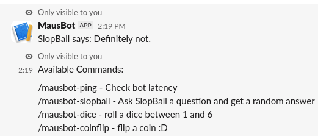

# M4usBot

A small Slack bot featuring fun commands, random answers, coin flips and dice rolls :D

## Showcase

## Try it out

[**Test out M4usBot**](https://app.slack.com/client/E09V59WQY1E/C0P5NE354)

## Features

- **Ping** (`/mausbot-ping`): Check the bot's ping
- **Help** (`/mausbot-help`): Display all commands
- **SlopBall** (`/mausbot-slopball`): Ask SlopBall a question and get a random answer
- **Coinflip** (`/mausbot-coinflip`): Pick Heads or Tails and see if you win!
- **Dice** (`/mausbot-dice`): Roll a dice between 1 and 6

## Run locally

Prerequisites

    Node.js (v18.x or newer) and npm installed.
    A Slack Workspace where you have permission to install apps

1. Clone this repo :D
2. Install the dependencies using `npm install`
3. Create a `.env` file with your Slack bot and app tokens
4. Start the bot using `node index.js`
5. Invite the bot to your Slack workspace and try out the commands :P

## AI disclosure

AI was used for debugging

## Credits

Made by me, dahmaus :D

Written in JavaScript using Node.js and Slack Bolt with love &lt;3
